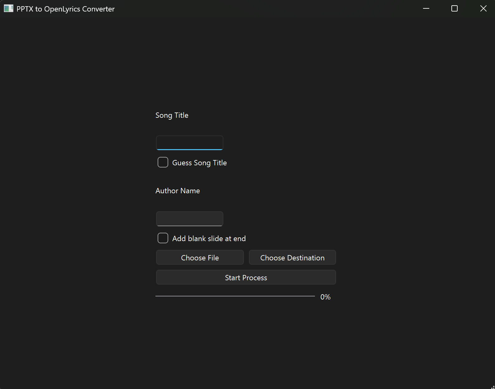

# PPTX to OpenLyrics

A small GUI program that extracts text from a PowerPoint presentation (`.pptx`) and writes an [OpenLyrics](https://openlyrics.org/) XML song file.

## Requirements

- Python 3.12 or newer
- A `.pptx` presentation
- The project dependency `python-pptx` (declared in `pyproject.toml`)

Sync with uv:

```powershell
uv sync
uv activate
```

## Usage

Run the script from the project directory:

```powershell
python main.py
```

The GUI is very simple and user-friendly, allowing you to select a PowerPoint file and choose which slides to include in the output.



The script writes an XML file by replacing `.pptx` in the entered filename with `.xml`. For the example above, the output is `songs\example.xml`.

## What it converts

- It visits slides in presentation order and checks each shape on each slide.
- For every shape with a text frame, it prints the shape's text and adds that text to the OpenLyrics XML.
- Each text-bearing shape becomes its own `<verse>` element. Verse names use the slide number (`verse1`, `verse2`, and so on), so multiple text-bearing shapes on the same slide produce multiple verses with the same name.
- The XML includes the prompted title and author, an OpenLyrics version of `0.8`, and the extracted text.
- Extracted shape text is also appended to `lines.txt` in the current working directory. Repeated runs append more text; they do not clear this file.

## Limitations

- The GUI is interactive; it does not accept command-line arguments.
- It does not infer song sections such as chorus or bridge. All extracted text is added as verses.
- Only shape text is extracted; images and other non-text slide content are not converted.

## License

This project is licensed under the MIT License. See [LICENSE](LICENSE).
